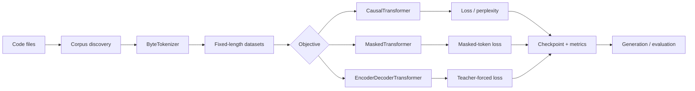

<div align="center">

# Transformer Craft

### A from-scratch Transformer laboratory for code intelligence

<p>
  <strong>PyTorch</strong> · <strong>Attention</strong> · <strong>MLM</strong> ·
  <strong>CLM</strong> · <strong>Encoder–Decoder</strong>
</p>

<p>
  <a href="https://github.com/ashucfx/transformer-craft">Repository</a> ·
  <a href="#quickstart">Quickstart</a> ·
  <a href="#architecture">Architecture</a> ·
  <a href="#roadmap">Roadmap</a>
</p>

<p>
  
  
  
  
</p>

</div>

> **Build the mechanism. Measure the behavior. Ship the experiment.**

Transformer Craft is a compact, inspectable PyTorch stack for training and
evaluating Transformer models on source code. Every major layer is implemented
locally: token preparation, masking, attention, objectives, optimization,
checkpointing, evaluation, and generation.

<details>
<summary><strong>Why this project?</strong></summary>

This repository is designed to make the full language-modeling path easy to
read, run, test, and extend. It favors explicit contracts over hidden
framework behavior:

- byte-preserving tokenization for arbitrary UTF-8 code
- causal, masked, and sequence-to-sequence objectives
- deterministic corpus discovery and validation splits
- atomic checkpoints with optimizer and scheduler state
- small public APIs backed by focused tests

</details>

## Contents

- [Capability map](#capability-map)
- [Architecture](#architecture)
- [Quickstart](#quickstart)
- [CLI cookbook](#cli-cookbook)
- [Python API](#python-api)
- [Project map](#project-map)
- [Engineering notes](#engineering-notes)
- [Quality gates](#quality-gates)
- [Roadmap](#roadmap)
- [License](#license)

## Capability map

| Area | Available now | Entry point |
|---|---|---|
| Causal language modeling | ✅ Next-token prediction | `CausalTransformer` |
| Masked language modeling | ✅ Masked-token prediction | `MaskedTransformer` |
| Sequence transformation | ✅ Cross-attention + teacher forcing | `EncoderDecoderTransformer` |
| Code ingestion | ✅ Recursive, filtered, deterministic | `discover_code_files` |
| Training | ✅ AMP, clipping, scheduler, resume | `transformer-craft train` |
| Evaluation | ✅ Loss and perplexity | `transformer-craft evaluate` |
| Generation | ✅ Temperature and top-k sampling | `transformer-craft generate` |
| Sequence-to-sequence CLI | ✅ Paired source/target training | `--objective seq2seq` |
| Experiment artifacts | ✅ Checkpoints, config, metrics | `checkpoints/<run>/` |
| Performance evidence | ✅ Parameters, latency, throughput | `transformer-craft benchmark` |
| Trainable tokenizer | ✅ Byte-pair encoding with persistence | `BPETokenizer` |
| Distributed execution | ✅ `torchrun`-compatible DDP | `torchrun ... cli.py train` |

## Architecture



### Attention paths

| Model | Encoder self-attention | Decoder self-attention | Cross-attention |
|---|:---:|:---:|:---:|
| `CausalTransformer` | — | ✅ causal | — |
| `MaskedTransformer` | ✅ bidirectional | — | — |
| `EncoderDecoderTransformer` | ✅ bidirectional | ✅ causal | ✅ |

## Quickstart

### 1. Install

<details open>
<summary><strong>Windows PowerShell</strong></summary>

```powershell
py -m venv .venv
.venv\Scripts\Activate.ps1
pip install -e ".[dev]"
```

</details>

<details>
<summary><strong>Linux / macOS</strong></summary>

```bash
python3 -m venv .venv
source .venv/bin/activate
pip install -e ".[dev]"
```

</details>

### 2. Run the quality gate

```powershell
pytest
ruff check .
```

### 3. Train a compact model

```powershell
transformer-craft train `
  --objective causal `
  --text-file data\sample.txt `
  --output-dir checkpoints\demo `
  --steps 100 `
  --batch-size 8 `
  --sequence-length 128
```

## CLI cookbook

<details>
<summary><strong>Train on a recursive code corpus</strong></summary>

```powershell
transformer-craft train `
  --objective causal `
  --corpus-dir data\code `
  --extensions .py,.js,.ts `
  --output-dir checkpoints\code `
  --steps 1000 `
  --validation-fraction 0.1
```

Files are discovered recursively in deterministic path order. The default
extensions are `.py`, `.js`, `.ts`, `.java`, `.cpp`, `.c`, `.rs`, and `.go`.

</details>

<details>
<summary><strong>Resume training</strong></summary>

```powershell
transformer-craft train `
  --objective causal `
  --text-file data\sample.txt `
  --output-dir checkpoints\demo `
  --steps 1000 `
  --resume-from checkpoints\demo\latest.pt
```

Each run can write `latest.pt`, `config.json`, `metrics.json`, `metrics.csv`,
`summary.json`, and `events.jsonl`. The CSV and JSON outputs are designed for
notebooks, dashboards, and external experiment trackers.

</details>

<details>
<summary><strong>Evaluate a checkpoint</strong></summary>

```powershell
transformer-craft evaluate `
  --checkpoint checkpoints\demo\latest.pt `
  --text-file data\sample.txt `
  --objective causal
```

The evaluator reports token-weighted cross-entropy and perplexity.

</details>

<details>
<summary><strong>Train an encoder-decoder model</strong></summary>

Place one source example and one target example on each corresponding line:

```powershell
transformer-craft train `
  --objective seq2seq `
  --text-file data\source.txt `
  --target-file data\target.txt `
  --output-dir checkpoints\transform `
  --steps 1000
```

The paired dataset prepends BOS to decoder inputs, appends EOS to labels, and
ignores padded target positions.

</details>

<details>
<summary><strong>Train a BPE tokenizer</strong></summary>

```python
from transformer_craft import BPETokenizer

tokenizer = BPETokenizer.train(corpus_text, vocab_size=1024)
tokenizer.save("artifacts/tokenizer.json")
```

The tokenizer preserves the four reserved IDs used by the datasets:
`<pad>`, `<mask>`, `<bos>`, and `<eos>`.

</details>

<details>
<summary><strong>Run distributed training</strong></summary>

```powershell
torchrun --standalone --nproc_per_node=2 `
  -m transformer_craft.cli train `
  --objective causal `
  --text-file data\sample.txt `
  --output-dir checkpoints\distributed `
  --steps 1000 `
  --device auto
```

Only rank zero writes checkpoints, event logs, and summaries. Use a shared
filesystem for `--output-dir` across workers.

</details>

<details>
<summary><strong>Generate code</strong></summary>

```powershell
transformer-craft generate `
  --checkpoint checkpoints\demo\latest.pt `
  --prompt "def fibonacci(n):" `
  --max-new-tokens 128 `
  --temperature 0.8 `
  --top-k 40 `
  --seed 42
```

Use `--top-k 1` for greedy-like sampling. Context is automatically bounded by
the model's configured maximum sequence length. Reusing `--seed` makes sampling
reproducible on the same device.

</details>

<details>
<summary><strong>Benchmark a checkpoint</strong></summary>

```powershell
transformer-craft benchmark `
  --checkpoint checkpoints\demo\latest.pt `
  --objective causal `
  --batch-size 4 `
  --steps 20
```

The command reports parameter count, milliseconds per step, tokens per second,
and CUDA peak memory when running on a GPU.

</details>

### Container usage

```powershell
docker build -t transformer-craft:0.2.0 .
docker run --rm transformer-craft:0.2.0 --help
docker run --rm `
  -v ${PWD}\checkpoints:/app/checkpoints `
  transformer-craft:0.2.0 benchmark `
  --checkpoint /app/checkpoints/demo/latest.pt
```

The image is intentionally CPU-compatible. Use a CUDA-enabled PyTorch base
image for GPU deployment.

For NVIDIA GPU hosts:

```powershell
docker build -f Dockerfile.cuda -t transformer-craft:0.2.0-cuda .
docker run --rm --gpus all transformer-craft:0.2.0-cuda --help
```

## Python API

```python
import torch

from transformer_craft import CausalTransformer, ModelConfig

config = ModelConfig(
    max_sequence_length=128,
    embedding_dimension=256,
    attention_heads=8,
    layers=6,
    feed_forward_dimension=1024,
)
model = CausalTransformer(config)
batch = torch.randint(0, config.vocab_size, (2, 128))
result = model(batch, labels=batch)

print(result["loss"].item())
```

## Project map

```text
transformer_craft/
├── config.py       validated model and training configuration
├── data.py         tokenizer, corpus discovery, datasets, and masking
├── modeling.py     attention, blocks, objectives, and cross-attention
├── training.py     optimizer, scheduler, checkpoints, and validation
├── inference.py    generation and token-weighted evaluation
├── benchmark.py    throughput and memory benchmark utilities
└── cli.py          train, evaluate, generate, and benchmark commands

tests/
├── test_data.py
├── test_corpus.py
├── test_modeling.py
├── test_sequence_data.py
├── test_training.py
├── test_inference.py
├── test_cli.py
├── test_bpe.py
└── test_distributed.py
```

## Engineering notes

<details>
<summary><strong>Data contracts</strong></summary>

`ByteTokenizer` preserves every UTF-8 byte and reserves IDs for padding,
masking, BOS, and EOS. `SequencePairDataset` creates independent encoder and
decoder masks, prepends BOS, appends EOS, and uses `-100` for ignored target
padding.

</details>

<details>
<summary><strong>Reproducibility</strong></summary>

Seeds control Python, PyTorch, CUDA, masking, and validation split ordering.
Resolved model and training configuration is stored with every checkpoint.

</details>

<details>
<summary><strong>Reliability</strong></summary>

Checkpoint writes use a temporary file followed by atomic replacement. Causal
and padding masks are combined inside attention, preventing padded batches from
silently disabling causal information flow.

</details>

<details>
<summary><strong>Operational boundary</strong></summary>

The current system is intentionally local: files in, checkpoints and metrics
out. Storage, experiment tracking, distributed execution, and production
tokenizers remain replaceable integrations rather than hidden dependencies.

</details>

## Quality gates

```powershell
pytest
ruff check .
py -m compileall -q transformer_craft tests
```

The test suite covers tensor shapes, causal information flow, cross-attention,
masking invariants, tokenizer behavior, corpus ordering, dataset splitting,
checkpoint round trips, validation metrics, generation, and CLI parsing.

## Roadmap

| Phase | Scope | Status |
|---|---|:---:|
| Foundation | Core models, datasets, CLI, packaging | ✅ |
| Training operations | Validation, resume, metrics, atomic checkpoints | ✅ |
| Sequence modeling | Encoder-decoder and teacher forcing | ✅ |
| Corpus tooling | Recursive multi-file discovery and filtering | ✅ |
| Tokenizer evolution | BPE training and tokenizer benchmarks | Planned |
| Scale-out | Distributed training and experiment tracking | Planned |
| Delivery | CI matrix, Docker image, benchmark reports | ✅ |
| Research scale | BPE tokenizer, distributed training, experiment exports | ✅ |

## Contributing

1. Create a focused branch.
2. Keep commits small and feature-oriented.
3. Add or update tests with behavior changes.
4. Run `pytest` and `ruff check .`.
5. Update the README when a public workflow changes.

## License

Released under the [MIT License](LICENSE).
